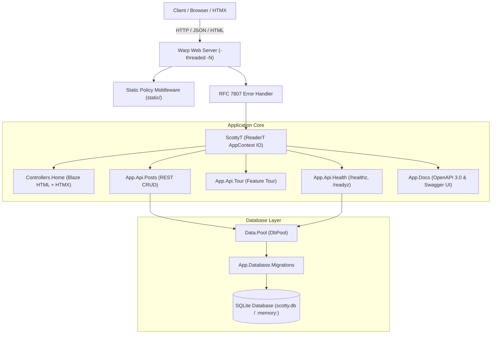

# Scotty Starter 2.0

> **A production-ready, battery-included web application starter kit for modern Haskell (GHC 9.10, Scotty 0.30, Warp, SQLite, and HTMX).**

[](https://github.com/tusharad/scotty-starter/actions/workflows/ci.yml)
[](LICENSE)
[](https://www.haskell.org/ghc/)
[](https://hackage.haskell.org/package/scotty)

---

## Highlights

* **Modern Haskell Toolchain:** Built for **GHC 9.10.3** and **Cabal 3.0+**, with Nix Flakes (`flake.nix`) and multi-compiler GitHub Actions CI (`GHC 9.6`, `9.8`, `9.10`).
* **High-Throughput Warp Runtime:** Configured with `-threaded -rtsopts -with-rtsopts=-N` for multi-core request parallelization.
* **Built-in Swagger UI & OpenAPI 3.0:** Declarative route documentation combinators based on [scotty-web/scotty PR #438](https://github.com/scotty-web/scotty/pull/438). Interactive Swagger UI served at `/docs` and raw spec at `/openapi.json`.
* **Pedagogical Scotty 0.30 Tour:** Endpoints covering path parameters, query parameters, Aeson JSON deserialization, multipart form submissions, headers, cookies, custom status codes, and HTTP redirects.
* **Production Database Layer:** Connection pooling via `resource-pool >= 0.4` and SQLite (`sqlite-simple >= 0.4`), backed by an automated transactional migration runner (`schema_migrations`).
* **RFC 7807 Problem Details:** Centralized exception handling formatting runtime errors into structured `application/problem+json` error payloads.
* **Zero-CDN Reactive Hypermedia:** Fully self-hosted HTMX 2.0.4 and Pure.css responsive base for real-time DOM mutations without heavy client-side JavaScript frameworks.
* **Comprehensive Automated Tests:** 30 integration test cases using `hspec-wai` and in-memory SQLite isolation.

---

## Architecture Overview



---

## Quickstart

### Prerequisites
* [GHC 9.6, 9.8, or 9.10](https://www.haskell.org/ghcup/)
* [Cabal 3.0+](https://www.haskell.org/cabal/)
* *(Optional)* [Docker](https://www.docker.com/) & [Make](https://www.gnu.org/software/make/)

### 1. Run the Development Server
```bash
# Clone the repository
git clone https://github.com/tusharad/scotty-starter.git
cd scotty-starter

# Run server with default SQLite configuration
cabal run scotty-starter

# Or using Make:
make run
```
Visit **http://localhost:3000** to explore the interactive laboratory console.

### 2. Run the Automated Test Suite
```bash
cabal test --test-show-details=direct

# Or using Make:
make test
```

### 3. Live Development Watcher
```bash
# Automatically runs test suite on every file modification using ghcid
make watch
```

---

## Project Layout

```text
scotty-starter/
├── app/
│   └── Main.hs                     # Executable entrypoint (runApp)
├── src/
│   ├── App.hs                      # WAI application specification & routing
│   ├── App/
│   │   ├── Config.hs               # Strongly-typed environment variables
│   │   ├── Context.hs              # ReaderT monad stack & connection pool
│   │   ├── Database.hs             # ResourcePool connection manager
│   │   ├── Database/
│   │   │   └── Migrations.hs       # Transactional migration runner
│   │   ├── Docs.hs                 # OpenAPI 3.0 spec & Swagger UI (PR #438)
│   │   ├── Middleware/
│   │   │   └── ErrorHandler.hs     # RFC 7807 problem details boundary
│   │   └── Api/
│   │       ├── Health.hs           # Operational probes (/healthz, /readyz)
│   │       ├── Posts.hs            # Database-backed RESTful CRUD routes
│   │       └── Tour.hs             # Pedagogical Scotty feature tour routes
│   ├── Controllers/
│   │   └── Home.hs                 # HTML & HTMX partial controllers
│   └── Views/
│       ├── Layout.hs               # Responsive HTML5 layout
│       ├── Home.hs                 # Studio & documentation page
│       └── Pages/Posts.hs          # Interactive hypermedia components
├── static/
│   ├── css/
│   │   ├── pure.min.css            # Responsive base stylesheet
│   │   ├── grids-responsive.min.css# Responsive grid rules
│   │   └── style.css               # Solarized amber & slate console theme
│   └── js/
│       └── htmx.min.js             # Self-hosted HTMX 2.0.4 library
├── test/
│   ├── Spec.hs                     # Hspec test discovery
│   └── AppSpec.hs                  # 30 HTTP integration test cases
├── Dockerfile                      # Multi-stage production container
├── docker-compose.yml              # Local container development config
├── flake.nix                       # Reproducible Nix developer shell
└── Makefile                        # Developer automation shortcuts
```

---

## API & Documentation

| Path | Method | Description |
| :--- | :--- | :--- |
| `/` | `GET` | Interactive Haskell Web Engineering Studio (HTML5 + HTMX) |
| `/docs` | `GET` | Interactive Swagger UI API documentation |
| `/openapi.json` | `GET` | OpenAPI 3.0.3 machine-readable specification |
| `/healthz` | `GET` | Liveness probe returning server status and uptime |
| `/readyz` | `GET` | Readiness probe verifying database connectivity |
| `/api/posts` | `GET`, `POST` | List posts (with `?q=` search) or create a new post |
| `/api/posts/:id` | `GET`, `PUT`, `DELETE` | Retrieve, update, or remove a specific post |
| `/api/tour/path-params/:category/:id` | `GET` | Path parameter extraction (`S.pathParam`) |
| `/api/tour/query-params` | `GET` | Optional and required query parameters |
| `/api/tour/json-body` | `POST` | Strongly-typed Aeson JSON deserialization |
| `/api/tour/form-params` | `POST` | URL-encoded multipart form body processing |
| `/api/tour/headers-and-cookies` | `GET` | Header inspection and cookie issuing |
| `/api/tour/status-codes/:code` | `GET` | Dynamic HTTP status code dispatch |
| `/api/tour/errors/:type` | `GET` | Scotty exception handling & RFC 7807 responses |

---

## Docker Workflow

### Run via Docker Compose
```bash
docker compose up --build
```
This runs the application with a persistent SQLite database volume mounted at `scotty-data`.

### Build Production Image Manually
```bash
docker build -t scotty-starter:latest .
docker run -p 3000:3000 scotty-starter:latest
```

---

## License

BSD-3-Clause © 2026 Tushar Adhatrao, Scotty Contributors.
